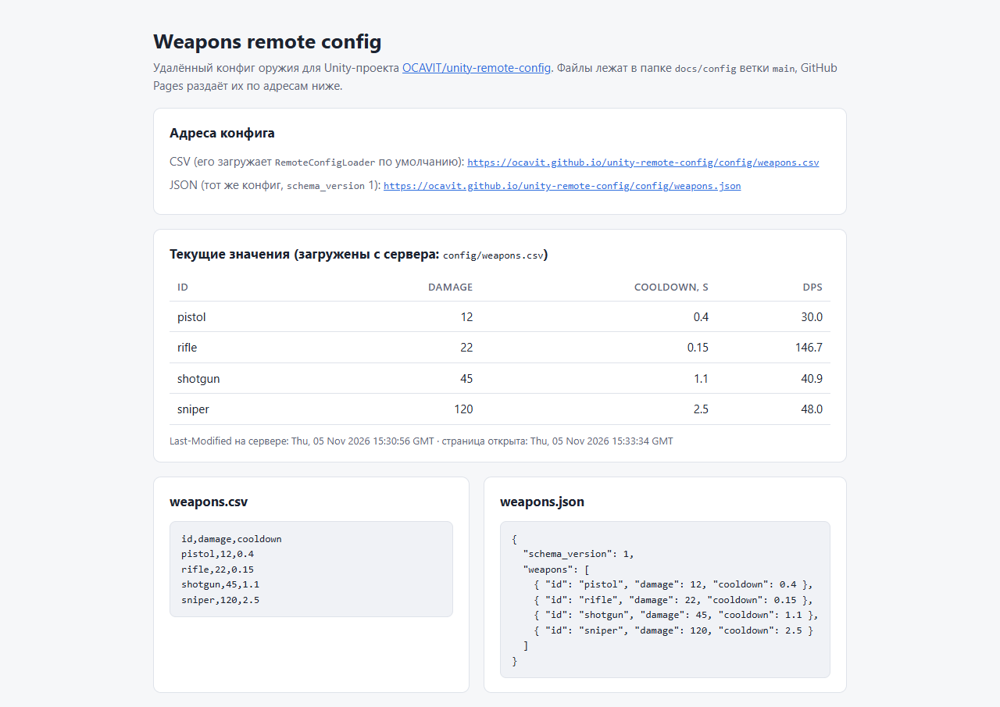
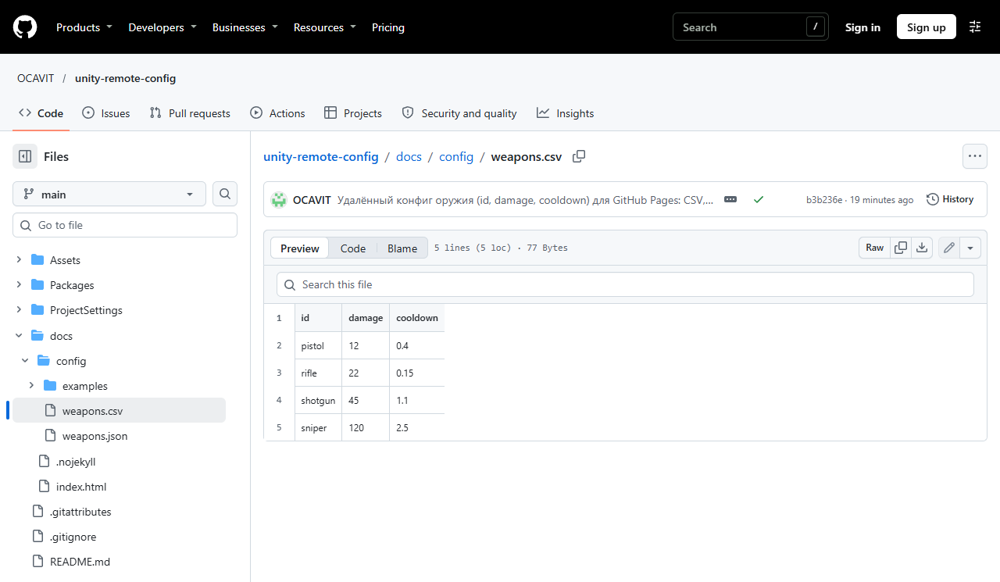
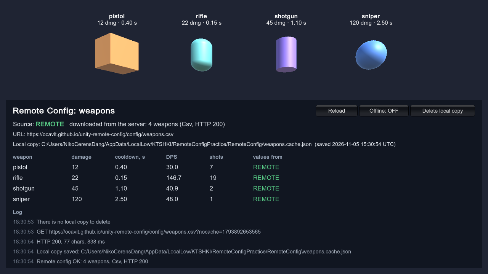
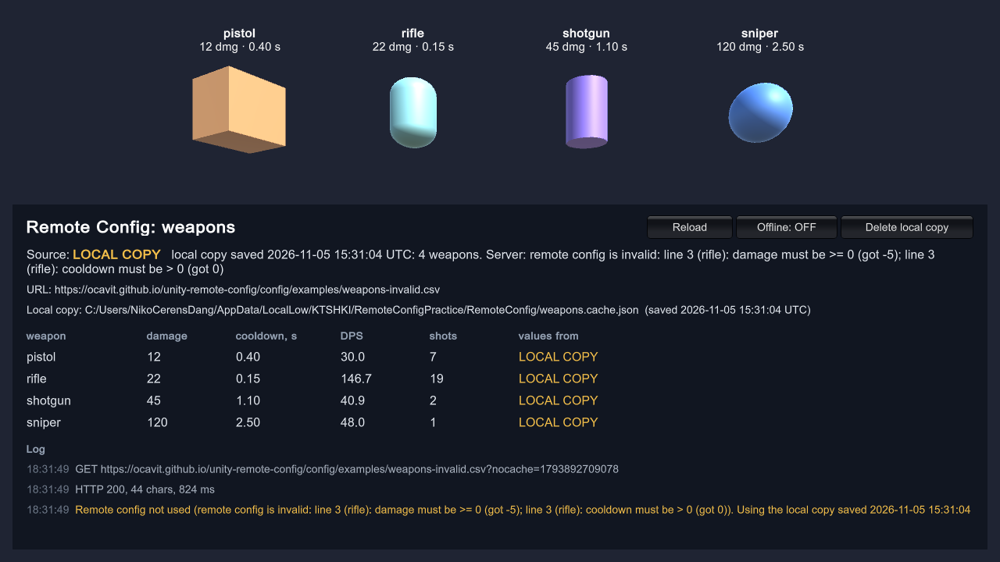
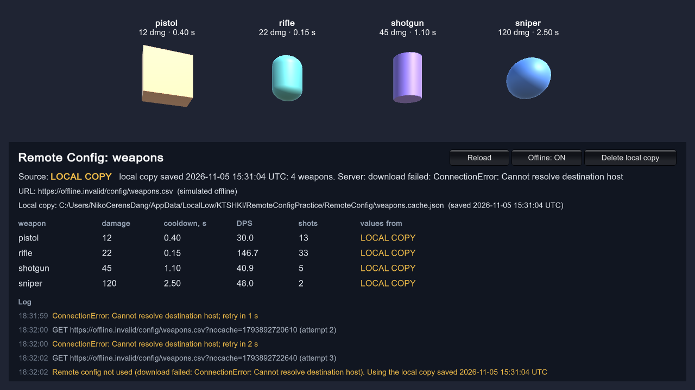
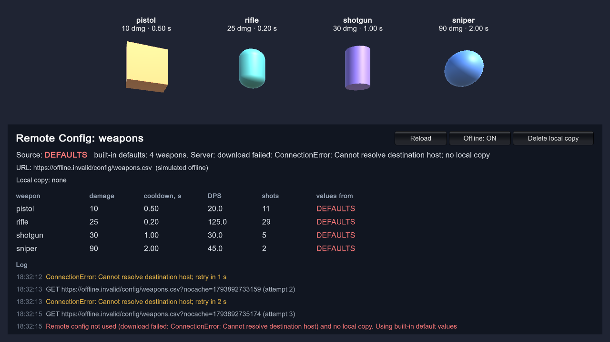

# Практика: удалённый конфиг (Remote Config) в Unity

Unity **6000.3.8f1**. `RemoteConfigLoader` скачивает конфиг оружия по URL, разбирает CSV или JSON и проверяет значения.
Валидный конфиг он сохраняет локальной копией и применяет к классу `Weapon`. Если загрузка не удалась, берётся
локальная копия. Если копии нет, применяются дефолты из кода, а ошибка пишется в лог.

- **Конфиг на сервере (GitHub Pages):** https://ocavit.github.io/unity-remote-config/config/weapons.csv.
  Тот же конфиг в JSON: [weapons.json](https://ocavit.github.io/unity-remote-config/config/weapons.json).
- **Страница с таблицей конфига:** https://ocavit.github.io/unity-remote-config/
- **Файл в репозитории:** [`docs/config/weapons.csv`](docs/config/weapons.csv)

## 1. Источник данных: конфиг на GitHub Pages

| id | damage | cooldown |
|---|---|---|
| pistol | 12 | 0.4 |
| rifle | 22 | 0.15 |
| shotgun | 45 | 1.1 |
| sniper | 120 | 2.5 |

Скрин конфига на сервере: страница на GitHub Pages загружает `config/weapons.csv` с сервера и показывает его таблицей.



Тот же файл в репозитории:



GitHub Pages раздаёт папку `docs` ветки `main` (Settings → Pages → Deploy from a branch → `main` / `docs`).

**Как поменять баланс.** Отредактируйте [`docs/config/weapons.csv`](docs/config/weapons.csv) на GitHub и сделайте коммит.
Примерно через минуту Pages опубликует новый файл. Игра получит новые значения при следующем запуске или по кнопке **Reload**.

**Google Sheets тоже подходит.** В таблице: Файл → Поделиться → Опубликовать в интернете → CSV. Полученную ссылку вставьте в поле
**URL** компонента `RemoteConfigLoader`. Парсер понимает такую выгрузку: кавычки, `\r\n`, BOM и дробные числа через
запятую (`"0,5"`) из таблицы с русской локалью.

JSON-вариант (`config/weapons.json`) устроен по схеме из теории: версия схемы и массив `weapons`.

```json
{
  "schema_version": 1,
  "weapons": [
    { "id": "pistol", "damage": 12, "cooldown": 0.4 },
    { "id": "rifle", "damage": 22, "cooldown": 0.15 }
  ]
}
```

## 2. RemoteConfigLoader

| Файл | Что делает |
|---|---|
| [`RemoteConfigLoader.cs`](Assets/Scripts/RemoteConfig/RemoteConfigLoader.cs) | `MonoBehaviour`: загрузка по URL (`UnityWebRequest`) и применение конфига к `Weapon` |
| [`WeaponConfigParser.cs`](Assets/Scripts/RemoteConfig/WeaponConfigParser.cs) | разбор CSV и JSON (`JsonUtility`) |
| [`WeaponConfigValidator.cs`](Assets/Scripts/RemoteConfig/WeaponConfigValidator.cs) | проверка записи: `id` не пустой, `damage ≥ 0`, `cooldown > 0` |
| [`ConfigCache.cs`](Assets/Scripts/RemoteConfig/ConfigCache.cs) | локальная копия в `Application.persistentDataPath` |
| [`ConfigResolver.cs`](Assets/Scripts/RemoteConfig/ConfigResolver.cs) | выбор источника: сервер → локальная копия → дефолты. Работает без сети и без `MonoBehaviour`, поэтому покрыт тестами |
| [`Weapon.cs`](Assets/Scripts/Weapons/Weapon.cs) | оружие с полями `damage` и `cooldown` |
| [`WeaponDefaults.cs`](Assets/Scripts/Weapons/WeaponDefaults.cs) | заранее прописанные дефолтные значения |
| [`ConfigDebugPanel.cs`](Assets/Scripts/Demo/ConfigDebugPanel.cs) | экран демо-сцены: источник, значения, лог, кнопки проверки |

Что происходит при загрузке:

1. **Загрузка по URL.** Запрос `GET` идёт с таймаутом 10 с. При сбое сети, таймауте, ответе 5xx или 429 запрос повторяется
   до 2 раз, с задержкой 1 с и 2 с. Ошибку 404 повтор не исправит, поэтому её не повторяем. К адресу добавляется
   `?nocache=<время>`, потому что CDN GitHub Pages кэширует файлы до 10 минут. Если есть локальная копия с того же адреса,
   отправляется `If-None-Match` с её ETag. Если конфиг не менялся, сервер отвечает 304 без тела.
2. **Разбор CSV или JSON.** Формат определяется по содержимому: `{` значит JSON, иначе CSV. Его можно и задать полем
   **Format**.
   - **CSV** разбирается по RFC 4180: поля в кавычках, запятые и `""` внутри полей, `\r\n`, BOM. Колонки находятся по
     заголовку, порядок любой, лишние колонки не мешают.
   - **JSON:** проверяется `schema_version`. Если версия чужая, конфиг не применяется. Если поля нет, это ошибка
     «missing», а не молчаливый ноль.
   - **HTML вместо конфига** (страница входа Google или страница ошибки хостинга) тоже считается ошибкой.
3. **Валидация.** Проверяются `damage ≥ 0`, `cooldown > 0` (конечное число), непустой и уникальный `id`. Ошибки
   называют строку, например `line 3 (rifle): cooldown must be > 0 (got 0)`. Если есть хотя бы одна ошибка, конфиг не
   применяется целиком и не сохраняется: частично битый баланс хуже прошлого рабочего.
4. **Локальная копия.** Валидный конфиг сохраняется как есть, вместе с адресом, ETag и временем, в файл
   `persistentDataPath/RemoteConfig/weapons.cache.json`. На Windows это
   `%USERPROFILE%\AppData\LocalLow\KTSHKI\RemoteConfigPractice\RemoteConfig\`. Запись атомарная: сначала во временный
   файл, затем подмена. Сбой посреди записи не испортит рабочую копию.
5. **Применение.** Каждый `Weapon` в сцене получает значения по своему `id`. Оружие, которого нет в конфиге, получает
   дефолт, а в лог уходит предупреждение.

Так выглядит локальная копия:

```json
{
    "sourceUrl": "https://ocavit.github.io/unity-remote-config/config/weapons.csv",
    "format": "Csv",
    "etag": "\"6aeca130-4d\"",
    "lastModified": "Thu, 05 Nov 2026 15:30:56 GMT",
    "savedAtUtc": "2026-11-05 15:31:04 UTC",
    "content": "id,damage,cooldown\npistol,12,0.4\nrifle,22,0.15\nshotgun,45,1.1\nsniper,120,2.5\n"
}
```

### Weapon: как продебажить

- **Инспектор.** В Play Mode выберите `Weapons/Weapon_pistol`. Поля `damage`, `cooldown`, `source` (откуда взяты значения),
  `shots` и `totalDamage` видно и можно менять прямо в инспекторе.
- **Консоль.** Меню компонента (⋮) → **Print values** выводит значения. Каждое применение конфига пишет строку вида
  `[Weapon] pistol: damage 12, cooldown 0.4 s, DPS 30 (Remote)`.
- **Отладчик.** В точке останова в `Weapon.Apply` видно, какие значения и из какого источника применяются.
- **В игре.** Оружие «стреляет» раз в `cooldown` секунд: вспышка и счётчик выстрелов. На экране таблица damage /
  cooldown / DPS / shots / источник.

## 3. Поведение при ошибках

| Ситуация | Что применяется | Лог |
|---|---|---|
| Сервер отдал валидный конфиг | конфиг с сервера; локальная копия обновляется | Log |
| Сервер ответил 304 Not Modified | локальная копия: она совпадает с серверной | Log |
| Нет сети, таймаут, 404, 5xx | локальная копия | Warning |
| Конфиг на сервере не прошёл валидацию | локальная копия; битый конфиг её не перезаписывает | Warning |
| Ошибка загрузки и нет локальной копии (или она повреждена) | дефолты из `WeaponDefaults` | **Error** |

Скрины из Windows-билда.

**Конфиг с сервера** (зелёный REMOTE): значения из `weapons.csv`, локальная копия сохранена.



**Конфиг на сервере битый** ([`examples/weapons-invalid.csv`](docs/config/examples/weapons-invalid.csv): у rifle
`damage = -5` и `cooldown = 0`). Валидация его отклонила, применена локальная копия.



**Нет сети** (кнопка Offline: запрос на несуществующий домен `.invalid`, это настоящая ошибка сети). После двух
повторов применена локальная копия.



**Нет сети и нет локальной копии.** Применены дефолты (`pistol 10 / 0.5`, `rifle 25 / 0.2` …), ошибка записана в лог.



Лог этого случая (Player.log):

```
[RemoteConfig] Local copy deleted: C:/Users/.../AppData/LocalLow/KTSHKI/RemoteConfigPractice\RemoteConfig\weapons.cache.json
[RemoteConfig] GET https://offline.invalid/config/weapons.csv?nocache=1793892731515
[RemoteConfig] ConnectionError: Cannot resolve destination host; retry in 1 s
[RemoteConfig] GET https://offline.invalid/config/weapons.csv?nocache=1793892733159 (attempt 2)
[RemoteConfig] ConnectionError: Cannot resolve destination host; retry in 2 s
[RemoteConfig] GET https://offline.invalid/config/weapons.csv?nocache=1793892735174 (attempt 3)
[RemoteConfig] Remote config not used (download failed: ConnectionError: Cannot resolve destination host) and no local copy. Using built-in default values
[Weapon] pistol: damage 10, cooldown 0.5 s, DPS 20 (Defaults)
[Weapon] rifle: damage 25, cooldown 0.2 s, DPS 125 (Defaults)
[Weapon] shotgun: damage 30, cooldown 1 s, DPS 30 (Defaults)
[Weapon] sniper: damage 90, cooldown 2 s, DPS 45 (Defaults)
```

## Как проверить самому

**В редакторе.** Откройте `Assets/Scenes/RemoteConfigDemo.unity` и нажмите Play. Кнопки на экране:
- **Reload** загружает конфиг заново;
- **Offline** имитирует отсутствие сети;
- **Delete local copy** удаляет локальную копию.

В меню **Remote Config** есть пункты Show Local Copy Folder, Delete Local Copy и Build Windows.

**В билде.** Ключи командной строки:
- `-configUrl <url>` — другой адрес конфига;
- `-offline` — режим без сети;
- `-clearConfigCache` — удалить локальную копию перед загрузкой;
- `-screenshot <файл>` — снять кадр после загрузки и выйти.

Скрины выше сняты так:

```bat
RemoteConfigPractice.exe -clearConfigCache -screenshot game-remote.png
RemoteConfigPractice.exe -configUrl https://ocavit.github.io/unity-remote-config/config/examples/weapons-invalid.csv -screenshot game-invalid-config.png
RemoteConfigPractice.exe -offline -screenshot game-local-copy.png
RemoteConfigPractice.exe -offline -clearConfigCache -screenshot game-defaults.png
```

## Тесты

20 EditMode-тестов в [`Assets/Tests/EditMode`](Assets/Tests/EditMode), все проходят. Запуск: Window → General →
Test Runner → EditMode → Run All, или из командной строки:

```bat
Unity.exe -batchmode -projectPath . -runTests -testPlatform EditMode -testResults TestResults.xml
```

Что проверяют тесты:
- **Разбор CSV:** BOM, `\r\n`, кавычки, порядок колонок, дробные через запятую. Ошибки валидации с номерами строк,
  дубли `id`, нет колонки, незакрытая кавычка.
- **Разбор JSON:** отсутствующие поля, `schema_version`, битый JSON. Ответ HTML или пустой ответ.
- **Цепочка источников:**
  - сервер: конфиг применяется и сохраняется копией;
  - нет сети: берётся копия;
  - битый конфиг: берётся копия и не перезаписывается;
  - нет ни сервера, ни копии: дефолты и ошибка в лог;
  - повреждённая копия: дефолты;
  - ответ 304: берётся копия.
- **Сами данные:** дефолты валидны, а опубликованные `docs/config/weapons.csv` и `weapons.json` валидны и совпадают.

## Структура

```
Assets/
  Scenes/RemoteConfigDemo.unity     демо-сцена: 4 оружия, RemoteConfigLoader, ConfigDebugPanel
  Scripts/RemoteConfig/             RemoteConfigLoader, разбор, валидация, локальная копия, выбор источника
  Scripts/Weapons/                  Weapon, WeaponDefaults
  Scripts/Demo/                     ConfigDebugPanel
  Editor/DemoSetup.cs               пересоздание сцены, сборка Windows, меню локальной копии
  Tests/EditMode/                   тесты
docs/                               GitHub Pages: config/weapons.csv, config/weapons.json, index.html, скрины
```
